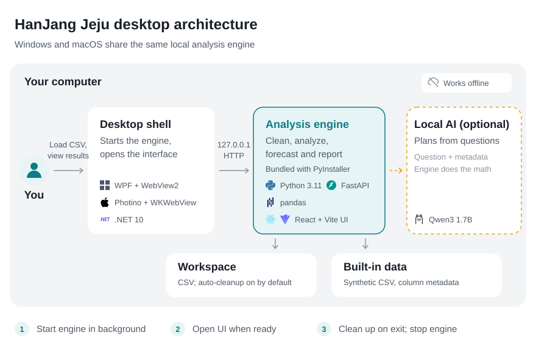
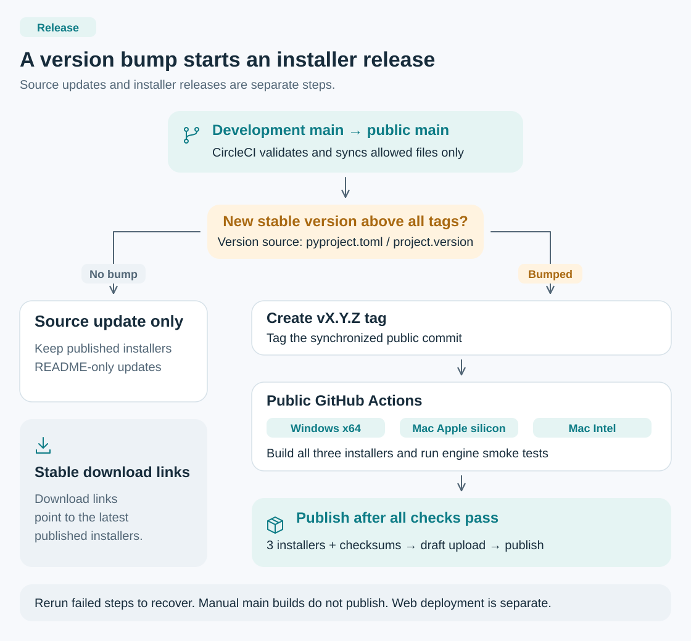

<p align="center"></p>

<h1 align="center">HanJang Jeju <sub>한 장 제주</sub></h1>

<p align="center"><strong>CSV から、数字の根拠がわかる 1 枚のレポートへ。</strong><br>デスクトップでデータを整え、変化を調べ、月次の推移を予測します。</p>

<p align="center"><a href="README.md">English</a> | <a href="README.ko.md">한국어</a> | <a href="README.zh-CN.md">简体中文</a> | <strong>日本語</strong></p>

<p align="center"><a href="https://hanjang-jeju.hyunolike.dev">Web デモを試す</a> · <a href="#get-started">デスクトップ版をダウンロード</a> · <a href="https://github.com/hyunolike/hanjang-jeju/releases/latest">最新リリース</a></p>

<p align="center">
  <a href="https://github.com/hyunolike/hanjang-jeju/releases/latest/download/HanJangJeju-Setup-windows-x64.exe"><picture><source media="(prefers-color-scheme: dark)" srcset="assets/dl-windows-ja-dark.svg"></picture></a>
  <a href="https://github.com/hyunolike/hanjang-jeju/releases/latest/download/HanJangJeju-mac-arm64.dmg"><picture><source media="(prefers-color-scheme: dark)" srcset="assets/dl-mac-arm64-ja-dark.svg"></picture></a>
  <a href="https://github.com/hyunolike/hanjang-jeju/releases/latest/download/HanJangJeju-mac-x64.dmg"><picture><source media="(prefers-color-scheme: dark)" srcset="assets/dl-mac-x64-ja-dark.svg"></picture></a>
</p>

HanJang Jeju は、済州ビッグデータセンターの CSV を、印刷や PDF 保存ができるレポートにまとめます。列の意味、欠損値、小計、単位を確認してから変化を調べられます。分析カードの数字は、ファクト ID から計算の根拠を確認できます。

**デスクトップ版は利用者の PC 内で分析します。** Web デモはアップロードされた CSV をサーバーに送信して分析します。PC の外へ出せないデータにはデスクトップ版を使ってください。

> 現在、アプリの画面、サンプルの列名、デモ動画は韓国語です。README の翻訳はアプリの多言語対応を意味しません。インストールと開発手順の基準は[英語版 README](README.md)です。

[デモ](#demo) · [機能](#features) · [はじめに](#get-started) · [使い方](#usage) · [データとプライバシー](#privacy) · [開発](#development) · [貢献](#contributing)

<a id="demo"></a>
## 22 秒でわかる HanJang Jeju

https://github.com/user-attachments/assets/9d5a5a77-5464-4ebb-a330-0ef7943ae91f

再生できない場合は[デモ動画をダウンロード](https://github.com/hyunolike/hanjang-jeju/raw/main/assets/intro.mp4)してください。[Web デモ](https://hanjang-jeju.hyunolike.dev)の内蔵サンプルから試すこともできます。

<a id="features"></a>
## できること

| 機能 | 内容と条件 |
| --- | --- |
| UTF-8/CP949 CSV の読み込みと整形 | 欠損値、秘匿された値、小計行を区別します |
| 変化、構成比、順位の分析 | 数値列と単位を確認してから計算します |
| 質問から分析計画を作成 | 任意のモデルが計画を提案し、コードが計算します。モデルなしの手動選択も可能です |
| 月次予測 | 24 か月以上のデータが必要です。80% 予測区間を表示します |
| 印刷と 1 ページ PDF 保存 | 選択条件、要約、数字の根拠を 1 枚に残します |

予測では、同じ月の値を繰り返す季節性ベースラインを使います。検証期間でより良い結果が得られた場合に AutoETS または AutoARIMA を選びます。推定値と観測値は区別して表示します。履歴が足りない場合や欠けている月がある場合は、予測の代わりに理由を表示します。

<a id="get-started"></a>
## はじめに

### デスクトップ版と Web 版を選ぶ

| | デスクトップ版 | [Web デモ](https://hanjang-jeju.hyunolike.dev) |
| --- | --- | --- |
| 向いている用途 | データを PC 内に保持したい場合 | アプリを試す場合や、公開可能な CSV を分析する場合 |
| CSV の処理 | 利用者の PC 内 | サーバーに送信し、リクエスト中に処理 |
| 任意の質問機能 | ローカルの Ollama | 接続済みの Cloudflare AI |
| モデルに送る情報 | 質問、列メタデータ、限定的なカテゴリ値の例 | 質問と列メタデータ。CSV の生データ行は送信しません |
| 入力の範囲 | アプリが読み込める CSV | 3 MiB、20,000 行、50 列以下の CSV |

Web 版には月次分析に適した日付と、合計できる数値が必要です。年だけの日付や、平均・比率など合計できない値には理由を表示します。内蔵サンプルは事前計算した集計結果でも体験できます。

### ダウンロードとインストール

以下のリンクは最新の公開インストーラーを指します。Mac のチップは **Apple メニュー → この Mac について**で確認できます。

| 対応環境 | ダウンロード |
| --- | --- |
| Windows 10/11、64 ビット | [Windows インストーラー（.exe）](https://github.com/hyunolike/hanjang-jeju/releases/latest/download/HanJangJeju-Setup-windows-x64.exe) |
| Apple シリコン搭載 Mac（M1 以降） | [Apple シリコン版（.dmg）](https://github.com/hyunolike/hanjang-jeju/releases/latest/download/HanJangJeju-mac-arm64.dmg) |
| Intel 搭載 Mac | [Intel 版（.dmg）](https://github.com/hyunolike/hanjang-jeju/releases/latest/download/HanJangJeju-mac-x64.dmg) |

[すべての配布ファイルと SHA256 チェックサム](https://github.com/hyunolike/hanjang-jeju/releases/latest)

**Windows：**インストーラーを実行します。管理者権限は不要です。コード署名がないため Windows SmartScreen が表示される場合があります。このリポジトリから取得したファイルであることを確認し、**詳細情報 → 実行**を選びます。スタートメニューから **한 장 제주** を開きます。初回のエンジン起動には 30〜60 秒ほどかかる場合があります。削除は**設定 → アプリ → インストールされているアプリ**から行います。

**macOS：**DMG を開き、アプリを**アプリケーション**フォルダへドラッグします。Apple の開発者証明書がないため、初回起動時に確認が必要な場合があります。macOS 15 以降では**システム設定 → プライバシーとセキュリティ → このまま開く**を使います。それ以前のバージョンでは Finder で **Control キーを押しながらクリック → 開く**を選びます。

### 任意：デスクトップで質問機能を使う

分析項目を手動で選ぶ場合、AI モデルは不要です。質問から項目を選びたい場合は [Ollama](https://ollama.com/download) をインストールして起動し、ターミナルまたは Windows PowerShell で次を実行します。

```bash
ollama pull qwen3:1.7b
```

モデルは PC 内で動作します。利用できない場合も手動で分析項目を選べます。アプリと任意のモデルの初回ダウンロードにはインターネットが必要ですが、デスクトップでの分析はインターネットや外部 AI サービスなしで実行できます。

<a id="usage"></a>
## CSV からレポートまで

1. **CSV を読み込みます。** 内蔵サンプルから始めることもできます。
2. **項目を確認します。** 日付、数値、単位、絞り込み条件を確認します。Web 版は候補を提案し、意味が曖昧な項目には確認を求めます。
3. **変化と根拠を調べます。** グラフと分析カードのファクト ID から計算の根拠を確認し、必要に応じて予測を依頼します。
4. **1 枚の結果を持ち出します。** 条件、要約、根拠の表を確認してから印刷、または PDF として保存します。

<a id="privacy"></a>
## データとプライバシー

**センターの原本データや大会主催者から提供された制限付き資料を、公開 Web デモにアップロードしないでください。** 公開インストーラーには、公開された列定義をもとに作成した架空のサンプル 2 種類を収録しています。実際のセンターデータや済州データハブの原本 CSV は含みません。

- **デスクトップ：**分析エンジンは `127.0.0.1` のみで待ち受けます。終了時の自動削除は初期状態で有効です。ウィンドウを閉じるとアップロードした作業ファイルを削除し、異常終了で残ったファイルは次の起動時に整理します。設定を無効にすることや、作業フォルダを手動で空にすることもできます。原本ファイルと別途保存した PDF は削除対象外です。
- **Web：**アップロードをリクエスト中に処理し、終了後にアップロード用リソースを閉じます。アップロード済みファイルの取得や永続保存機能は提供しません。計画用モデルに生データ行を送らなくても、CSV 自体はサーバーへ送信されます。

<a id="development"></a>
## 開発

Windows は WPF と WebView2、macOS は Photino と WKWebView を使います。両デスクトップアプリは Python 分析エンジンと React の画面を共有します。任意のローカルモデルが計画を作り、エンジンが数値を計算します。

<p align="center"><picture><source media="(prefers-color-scheme: dark)" srcset="assets/system-architecture-en-dark.svg"></picture></p>

<details>
<summary>ソースから実行・ビルドする</summary>

Python 3.11 以降、[uv](https://docs.astral.sh/uv/)、Node.js 22、pnpm 10 が必要です。デスクトップビルドには .NET 10、Windows インストーラーには Inno Setup も必要です。

```bash
git clone https://github.com/hyunolike/hanjang-jeju.git
cd hanjang-jeju
uv sync --frozen
bash scripts/run-web.sh
```

Windows ではシェルスクリプトの代わりに `scripts\run-web.bat` を使います。パッケージ作成の全手順は [release workflow](.github/workflows/release.yml) を参照してください。

```bash
cd web
pnpm install --frozen-lockfile
pnpm build
cd ..
JEJU_PUBLIC=1 uv run pyinstaller packaging/engine.spec --noconfirm --distpath output/dist --workpath output/build
```

macOS では続けて `JEJU_PUBLIC=1 mac/build-app.sh` を実行すると、公開版エンジン、アプリ、DMG を作成します。Windows では `dotnet publish` でアプリをビルドし、エンジンと一緒に Inno Setup でパッケージ化します。バージョンは `pyproject.toml` の `project.version` を使います。Windows インストーラーを手動作成する場合は、`uv run python scripts/release_version.py` の出力を `APP_VERSION` 環境変数に設定します。

</details>

### インストーラーのリリース手順

このリポジトリは、開発元から明示的な許可リストに沿って同期される公開配布用リポジトリです。同じバージョンの更新ではソースのみが変わり、公開済みインストーラーは変わりません。既存タグより高い新しい安定版では、公開タグの作成、Windows x64 と macOS arm64/x64 のビルド、エンジンのスモークテストを実行します。すべて成功したらインストーラーとチェックサムをドラフトへアップロードして公開します。Web のデプロイは別で、`main` の手動ビルドは Release を公開しません。

<p align="center"><picture><source media="(prefers-color-scheme: dark)" srcset="assets/release-automation-en-dark.svg"></picture></p>

実際にダウンロードできるバージョンは [GitHub Releases](https://github.com/hyunolike/hanjang-jeju/releases/latest) で確認してください。

<a id="contributing"></a>
## フィードバックと貢献

不具合や翻訳の改善は [Issue](https://github.com/hyunolike/hanjang-jeju/issues) でお知らせください。OS、アプリのバージョン、再現手順、期待する結果と実際の結果を記載します。データが必要な場合は最小限の架空 CSV を使い、機密ファイルは添付しないでください。

この公開リポジトリは開発元から生成されます。ここで直接変更すると、次の同期で上書きされることがあります。コードや翻訳の変更は、保守されている元ファイルへ反映できるよう、先に Issue で相談してください。機能やインストール手順を変更する際は、4 言語の README を一緒に更新します。

<a id="credits"></a>
## プロジェクトについて

済州 AI・ビッグデータ活用 AI Agent 開発チャレンジへの応募作品です。企画、デザイン、開発は [hyunolike](https://github.com/hyunolike) が担当しています。

pandas、statsforecast、FastAPI、uvicorn、PyInstaller、React、Vite、Tailwind CSS、Microsoft WebView2、Photino.NET、Inno Setup を使用しています。各依存ライブラリはそれぞれのライセンスに従います。現在、このリポジトリにはプロジェクトの `LICENSE` ファイルがありません。
