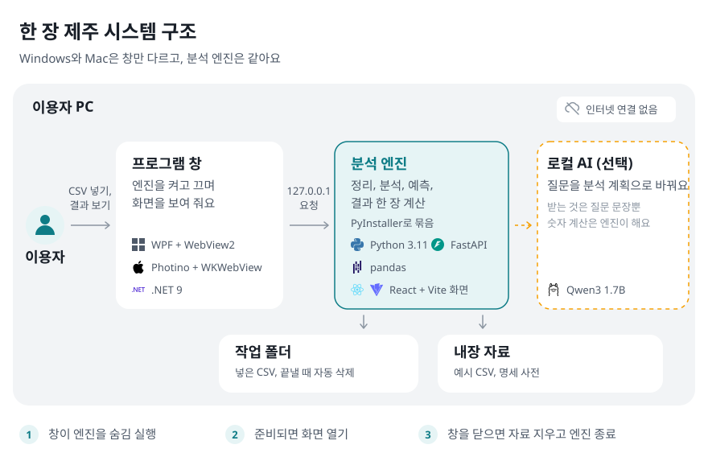
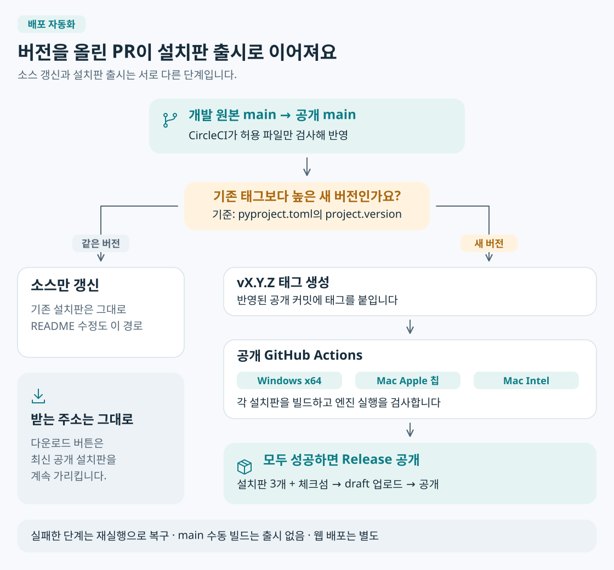

<p align="center"></p>

<h1 align="center">한 장 제주 <sub>HanJang Jeju</sub></h1>

<p align="center"><strong>CSV에서 보고서에 붙일 결과 한 장까지.</strong><br>자료를 정리하고 변화를 찾고, 숫자의 근거를 함께 보여 줍니다.</p>

<p align="center"><a href="README.md">English</a> | <strong>한국어</strong> | <a href="README.zh-CN.md">简体中文</a> | <a href="README.ja.md">日本語</a></p>

<p align="center"><a href="https://hanjang-jeju.hyunolike.dev">웹으로 먼저 써 보기</a> · <a href="#get-started">PC에 설치하기</a> · <a href="https://github.com/hyunolike/hanjang-jeju/releases/latest">최신 출시판</a></p>

<p align="center">
  <a href="https://github.com/hyunolike/hanjang-jeju/releases/latest/download/HanJangJeju-Setup-windows-x64.exe"><picture><source media="(prefers-color-scheme: dark)" srcset="assets/dl-windows-dark.svg"></picture></a>
  <a href="https://github.com/hyunolike/hanjang-jeju/releases/latest/download/HanJangJeju-mac-arm64.dmg"><picture><source media="(prefers-color-scheme: dark)" srcset="assets/dl-mac-arm64-dark.svg"></picture></a>
  <a href="https://github.com/hyunolike/hanjang-jeju/releases/latest/download/HanJangJeju-mac-x64.dmg"><picture><source media="(prefers-color-scheme: dark)" srcset="assets/dl-mac-x64-dark.svg"></picture></a>
</p>

한 장 제주는 제주빅데이터센터에서 받은 CSV를 분석해 인쇄하거나 PDF로 저장할 수 있는 결과 한 장을 만듭니다. 열 이름과 빈 값, 소계와 단위를 확인하고 변화를 살펴보세요. 분석 카드의 숫자는 사실 번호로 근거를 확인할 수 있습니다.

**PC용 프로그램은 내 컴퓨터 안에서 분석합니다.** 웹 체험판은 업로드한 CSV를 서버로 보내 분석합니다. 내 PC 밖으로 나가면 안 되는 자료는 PC판에서 사용하세요.

> 현재 앱 화면과 예시의 열 이름, 소개 영상은 한국어입니다. 이 문서의 번역은 앱의 언어 설정을 바꾸지 않습니다. 설치와 개발 안내의 기준 문서는 [영문 README](README.md)입니다.

[데모](#demo) · [기능](#features) · [시작하기](#get-started) · [사용 방법](#usage) · [데이터 처리](#privacy) · [개발](#development) · [기여](#contributing)

<a id="demo"></a>
## 22초로 보는 한 장 제주

https://github.com/user-attachments/assets/9d5a5a77-5464-4ebb-a330-0ef7943ae91f

영상이 보이지 않으면 [소개 영상 내려받기](https://github.com/hyunolike/hanjang-jeju/raw/main/assets/intro.mp4)로 볼 수 있습니다. [웹 체험판](https://hanjang-jeju.hyunolike.dev)에서 내장 예시로 시작할 수도 있습니다.

<a id="features"></a>
## 할 수 있는 일

| 기능 | 알아 둘 점 |
| --- | --- |
| UTF-8/CP949 CSV 읽기와 정리 | 빈 값, 가려진 값과 소계 행을 구분합니다 |
| 기간별 변화와 구성비, 순위 분석 | 계산 가능한 값과 단위를 확인한 뒤 분석합니다 |
| 질문으로 분석 계획 만들기 | 선택 사항인 모델이 계획을 만들고 계산은 코드가 합니다. 모델 없이 직접 선택할 수도 있습니다 |
| 월별 예측 | 최소 24개월이 필요하며 80% 예측 구간을 함께 보여 줍니다 |
| 인쇄와 PDF 저장 | 선택 조건과 요약, 숫자 근거를 결과 한 장에 남깁니다 |

예측은 같은 달의 값을 반복하는 계절 기준선으로 시작합니다. 검증 구간에서 더 나은 경우 AutoETS나 AutoARIMA를 선택합니다. 추정값은 실제 관측값과 구분합니다. 자료가 부족하거나 빈 달이 있으면 예측 대신 이유를 안내합니다.

<a id="get-started"></a>
## 시작하기

### PC와 웹, 어디서 쓸까요?

| | PC용 프로그램 | [웹 체험판](https://hanjang-jeju.hyunolike.dev) |
| --- | --- | --- |
| 이런 때 쓰세요 | 자료를 내 PC 안에서 분석할 때 | 설치 전에 체험하거나 공개 가능한 CSV를 분석할 때 |
| CSV 처리 | 내 PC에서 처리 | 서버로 전송해 요청 중 처리 |
| 선택 사항인 질문 기능 | 로컬 AI 팩(llama.cpp) 또는 Ollama | 연결된 Cloudflare AI |
| 모델에 보내는 정보 | 질문, 열 정의와 제한된 분류 값 예시 등 계획용 정보 | 질문과 열 정의 등 계획용 정보. CSV 원본 행은 보내지 않음 |
| 입력 범위 | 프로그램에서 읽을 수 있는 CSV | 3 MiB, 20,000행, 50열 이하 CSV |

웹에서는 월별 분석에 쓸 날짜와 합산 가능한 값이 필요합니다. 연도만 있거나 평균, 비율처럼 합산할 수 없는 값은 이유를 안내합니다. 내장 예시는 미리 계산한 집계 결과로도 체험할 수 있습니다.

### 내려받고 설치하기

아래 링크는 최신 공개 설치판을 가리킵니다. 내 Mac의 칩은 **Apple 메뉴 → 이 Mac에 관하여**에서 확인합니다.

| 컴퓨터 | 내려받기 |
| --- | --- |
| Windows 10/11, 64비트 | [Windows 설치 파일 (.exe)](https://github.com/hyunolike/hanjang-jeju/releases/latest/download/HanJangJeju-Setup-windows-x64.exe) |
| Windows AI 팩 (선택, 약 1.1GB) | [AI 팩 설치 파일 (.exe)](https://github.com/hyunolike/hanjang-jeju/releases/latest/download/HanJangJeju-AI-Pack-windows-x64.exe) |
| Mac, Apple 칩(M1 이후) | [Apple 칩용 (.dmg)](https://github.com/hyunolike/hanjang-jeju/releases/latest/download/HanJangJeju-mac-arm64.dmg) |
| Mac, Intel 칩 | [Intel용 (.dmg)](https://github.com/hyunolike/hanjang-jeju/releases/latest/download/HanJangJeju-mac-x64.dmg) |

[모든 설치 파일과 SHA256 체크섬 보기](https://github.com/hyunolike/hanjang-jeju/releases/latest)

**Windows:** 설치 파일을 실행합니다. 관리자 권한은 필요하지 않습니다. 코드 서명이 없어 **Windows의 PC 보호**가 표시되면 이 저장소에서 받은 파일인지 확인한 뒤 **추가 정보 → 실행**으로 진행합니다. 시작 메뉴에서 **한 장 제주**를 엽니다. 첫 엔진 준비에는 30초에서 1분 정도 걸릴 수 있습니다. 삭제는 **설정 → 앱 → 설치된 앱**에서 합니다.

**macOS:** DMG를 열고 앱을 **응용 프로그램** 폴더로 끌어다 놓습니다. Apple 개발자 인증서가 없어 첫 실행에 확인 안내가 나타날 수 있습니다. macOS 15 이후에서는 **시스템 설정 → 개인정보 보호 및 보안 → 그래도 열기**로 진행합니다. 이전 버전에서는 Finder에서 **Control+클릭 → 열기**를 사용합니다.

### 선택 사항: PC에서 질문 기능 켜기

직접 항목을 고르는 분석에는 AI 모델이 필요하지 않습니다. Windows에서 질문으로 분석할 항목을 고르려면 프로그램을 닫고 [AI 팩 설치 파일](https://github.com/hyunolike/hanjang-jeju/releases/latest/download/HanJangJeju-AI-Pack-windows-x64.exe)을 실행한 뒤 **한 장 제주**를 다시 엽니다. 받은 뒤에는 관리자 권한과 인터넷이 필요 없어 USB로 옮겨 설치할 수 있습니다. 모델을 다 불러오면 질문 칸에 **로컬 AI 준비됨 (Qwen3 1.7B, AI 팩)**이 보입니다. 처음 불러올 때는 1분쯤 걸릴 수 있습니다.

AI 팩에는 버전을 고정한 llama.cpp CPU용 서버와 Qwen3 1.7B 모델(Q4_K_M)이 들어 있습니다. 프로그램이 켜질 때 `127.0.0.1`에서만, 실행마다 새로 만든 열쇠로 실행하고 창을 닫으면 함께 끕니다. 모델에는 질문, 열 정의와 제한된 분류 값 예시만 보내고 CSV 원본 행은 보내지 않습니다.

Mac이거나 이미 [Ollama](https://ollama.com/download)를 쓰고 있다면 Ollama를 설치하고 실행한 뒤 터미널 또는 Windows PowerShell에서 모델을 받습니다.

```bash
ollama pull qwen3:1.7b
```

모델이 없으면 직접 항목을 골라 분석할 수 있습니다. PC 분석은 인터넷이나 외부 AI 없이 실행됩니다.

<a id="usage"></a>
## CSV에서 결과 한 장까지

1. **CSV를 넣습니다.** 내 파일을 선택하거나 내장 예시로 시작합니다.
2. **항목을 확인합니다.** 날짜와 값, 단위와 조건을 확인합니다. 웹에서는 후보를 추천하고 뜻이 불명확한 값은 확인을 요청합니다.
3. **변화와 근거를 봅니다.** 그래프와 분석 카드의 사실 번호로 계산 근거를 확인합니다. 필요한 경우 예측을 요청합니다.
4. **결과 한 장을 가져갑니다.** 조건, 요약과 근거 표를 확인한 뒤 인쇄하거나 PDF로 저장합니다.

<a id="privacy"></a>
## 데이터 처리와 보관

**센터 원본과 주최 제공 제한 자료는 공개 웹에 넣지 마세요.** 공개 설치판에는 공개 명세서의 열 정의로 만든 가짜 값 예시 2종이 들어 있습니다. 실제 센터 자료나 제주데이터허브 원본 CSV는 포함하지 않습니다.

- **PC:** 분석 엔진은 `127.0.0.1`에서만 열립니다. **끝낼 때 자동 지우기**는 기본으로 켜져 있습니다. 창을 닫을 때 업로드한 작업 파일을 지우고, 비정상 종료로 남은 파일은 다음 시작 때 정리합니다. 설정을 끄거나 직접 작업 폴더를 비울 수도 있습니다. 원본 파일과 따로 저장한 PDF는 이 정리 대상에 포함되지 않습니다.
- **웹:** 업로드 파일을 요청 중 처리하고 처리가 끝나면 업로드 자원을 닫습니다. 파일 조회나 영구 보관 기능을 제공하지 않습니다. 모델에 원본 행을 보내지 않더라도 CSV 자체는 서버로 전송됩니다.

<a id="development"></a>
## 개발

Windows는 WPF와 WebView2, macOS는 Photino와 WKWebView로 창을 엽니다. 두 앱은 같은 Python 분석 엔진과 React 화면을 사용합니다. 선택 사항인 로컬 모델은 계획을 만들고 엔진이 숫자를 계산합니다.

<p align="center"><picture><source media="(prefers-color-scheme: dark)" srcset="assets/system-architecture-dark.svg"></picture></p>

<details>
<summary>소스에서 실행하고 빌드하기</summary>

Python 3.11 이상, [uv](https://docs.astral.sh/uv/), Node.js 22와 pnpm 10이 필요합니다. 앱 빌드에는 .NET 10, Windows 설치판에는 Inno Setup이 추가로 필요합니다.

```bash
git clone https://github.com/hyunolike/hanjang-jeju.git
cd hanjang-jeju
uv sync --frozen
bash scripts/run-web.sh
```

Windows에서는 셸 스크립트 대신 `scripts\run-web.bat`를 사용합니다. 전체 패키징 순서는 [release workflow](.github/workflows/release.yml)를 따릅니다.

```bash
cd web
pnpm install --frozen-lockfile
pnpm build
cd ..
JEJU_PUBLIC=1 uv run pyinstaller packaging/engine.spec --noconfirm --distpath output/dist --workpath output/build
```

Mac에서는 이어서 `JEJU_PUBLIC=1 mac/build-app.sh`를 실행하면 공개용 엔진과 앱, DMG를 만듭니다. Windows에서는 `dotnet publish`로 앱을 만들고 엔진을 함께 넣은 뒤 Inno Setup으로 묶습니다. 버전은 `pyproject.toml`의 `project.version`을 사용합니다. Windows 설치판을 직접 만들 때는 `uv run python scripts/release_version.py`의 출력을 `APP_VERSION` 환경변수로 설정합니다.

</details>

### 설치판이 출시되는 과정

이 저장소는 개발 원본에서 허용한 파일을 자동 반영한 공개 배포판입니다. 버전이 같으면 소스만 바뀌고 공개 설치판은 유지합니다. 기존 태그보다 높은 새 안정판이면 공개 태그를 만들고 Windows x64와 macOS arm64/x64를 빌드해 엔진 실행을 검사합니다. 모두 성공하면 설치판과 체크섬을 draft에 올린 뒤 공개합니다. 웹 배포는 별도이며 `main` 수동 빌드는 Release를 만들지 않습니다.

<p align="center"><picture><source media="(prefers-color-scheme: dark)" srcset="assets/release-automation-dark.svg"></picture></p>

실제 내려받을 수 있는 버전은 [GitHub Releases](https://github.com/hyunolike/hanjang-jeju/releases/latest)를 기준으로 확인하세요.

<a id="contributing"></a>
## 피드백과 기여

오류나 번역 개선 사항은 [Issues](https://github.com/hyunolike/hanjang-jeju/issues)에 남겨 주세요. OS와 앱 버전, 재현 순서, 기대한 결과와 실제 결과를 함께 적습니다. 자료가 필요하면 최소한의 가짜 CSV를 사용하고 비공개 파일은 첨부하지 마세요.

공개 저장소의 파일은 개발 원본에서 생성됩니다. 여기서 직접 고치면 다음 동기화 때 덮어써질 수 있습니다. 코드나 번역 변경은 먼저 이슈로 논의해 관리 중인 원본에 반영합니다. 기능이나 설치 방법이 바뀌면 네 언어 README를 함께 갱신합니다.

<a id="credits"></a>
## 프로젝트 안내

「제주 AI·빅데이터 활용 AI Agent 개발 챌린지」 출품작입니다. 기획, 디자인과 개발은 [hyunolike](https://github.com/hyunolike)가 맡았습니다.

pandas, statsforecast, FastAPI, uvicorn, PyInstaller, React, Vite, Tailwind CSS, Microsoft WebView2, Photino.NET과 Inno Setup을 사용합니다. 각 의존성의 라이선스를 따릅니다. 현재 이 저장소에는 프로젝트 `LICENSE` 파일이 없습니다.
