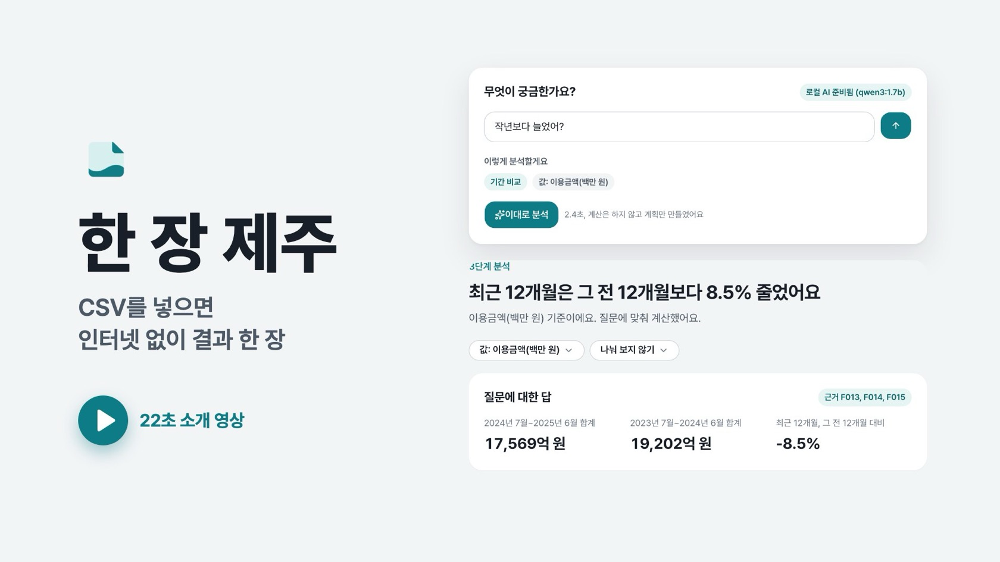
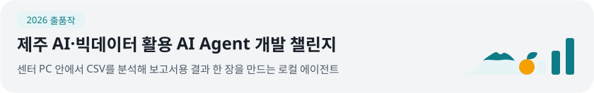

<p align="center"></p>

<h1 align="center">한 장 제주</h1>

<p align="center">CSV를 넣으면 인터넷과 외부 AI 없이 정리, 분석, 예측까지 해서<br>보고서에 붙일 결과 한 장을 만드는 PC 프로그램</p>

<p align="center">
  <a href="https://github.com/hyunolike/hanjang-jeju/releases/latest/download/HanJangJeju-Setup-windows-x64.exe"><picture><source media="(prefers-color-scheme: dark)" srcset="assets/dl-windows-dark.svg"></picture></a>
  <a href="https://github.com/hyunolike/hanjang-jeju/releases/latest/download/HanJangJeju-mac-arm64.dmg"><picture><source media="(prefers-color-scheme: dark)" srcset="assets/dl-mac-arm64-dark.svg"></picture></a>
  <a href="https://github.com/hyunolike/hanjang-jeju/releases/latest/download/HanJangJeju-mac-x64.dmg"><picture><source media="(prefers-color-scheme: dark)" srcset="assets/dl-mac-x64-dark.svg"></picture></a>
</p>

<p align="center"><a href="../../releases/latest">모든 파일과 체크섬</a> | <a href="https://hanjang-jeju.hyunolike.dev">웹 체험판</a></p>

<p align="center"><a href="#소개-영상"></a></p>

<p align="center"><picture><source media="(prefers-color-scheme: dark)" srcset="assets/hero-2026-dark.svg"></picture></p>

<p align="center"><sub>주최</sub><br><picture><source media="(prefers-color-scheme: dark)" srcset="assets/organizer-jtp-dark.svg"></picture></p>

제주빅데이터센터 PC에서 내려받은 CSV를 그 PC 안에서 바로 분석하려고 만들었습니다. 자료는 PC 밖으로 나가지 않습니다. 분석 엔진은 이 PC의 `127.0.0.1`에서만 열리고, 프로그램을 끝내면 넣은 자료를 지웁니다(끌 수 있음).

## 소개 영상

<p align="center"></p>

<p align="center"><sub>소리가 있는 영상은 <a href="https://github.com/hyunolike/hanjang-jeju/raw/main/assets/intro.mp4">intro.mp4</a>로 내려받아 볼 수 있어요 (22초, 2.8MB)</sub></p>

## 내려받기

위 버튼을 누르면 최신 버전을 바로 받습니다. 내 Mac의 칩은 **Apple 메뉴 → 이 Mac에 관하여**에서 확인합니다.

| 컴퓨터 | 파일 |
| --- | --- |
| Windows 10/11 (64비트) | [`HanJangJeju-Setup-windows-x64.exe`](https://github.com/hyunolike/hanjang-jeju/releases/latest/download/HanJangJeju-Setup-windows-x64.exe) |
| Mac (Apple 칩, M1 이후) | [`HanJangJeju-mac-arm64.dmg`](https://github.com/hyunolike/hanjang-jeju/releases/latest/download/HanJangJeju-mac-arm64.dmg) |
| Mac (Intel) | [`HanJangJeju-mac-x64.dmg`](https://github.com/hyunolike/hanjang-jeju/releases/latest/download/HanJangJeju-mac-x64.dmg) |

이 공개판에는 예시 자료로 **센터 자료 예시(공개 명세서의 열 정의로 만든 가짜 값)** 2종만 들어 있습니다. 내 CSV를 끌어다 놓으면 그 자료를 분석합니다.

## 설치

### Windows

1. `HanJangJeju-Setup-windows-x64.exe`를 실행합니다. 관리자 권한은 필요 없습니다.
2. 코드 서명이 없어서 **"Windows의 PC 보호"** 창이 뜹니다. **추가 정보 → 실행**을 누릅니다.
3. 시작 메뉴에서 **한 장 제주**를 엽니다. 처음 켤 때는 30초에서 1분쯤 걸립니다.

지울 때는 **설정 → 앱 → 설치된 앱**에서 "한 장 제주"를 제거합니다.

### Mac

1. dmg를 열고 **한 장 제주**를 응용 프로그램 폴더로 끌어다 놓습니다.
2. 처음 열 때 "확인할 수 없습니다" 안내가 뜨면 다음 중 하나로 엽니다.
    - macOS 15 이후: **시스템 설정 → 개인정보 보호 및 보안** 아래쪽의 **그래도 열기**를 누릅니다.
    - macOS 14 이전: Finder에서 앱을 **Control+클릭 → 열기**를 누릅니다.
    - 그래도 안 열리면 터미널에서 `xattr -dr com.apple.quarantine "/Applications/HanJangJeju.app"`를 입력합니다.

### 질문 기능 (선택)

"애월읍 어떤 업종 매출 비중이 커?" 같은 질문을 쓰려면 로컬 AI를 설치합니다. 설치하지 않아도 나머지 기능은 모두 쓸 수 있습니다.

1. https://ollama.com/download 에서 Ollama를 설치합니다.
2. 터미널(Windows는 PowerShell)에서 `ollama pull qwen3:1.7b`를 입력합니다(약 1.4GB).

모델은 이 PC 안에서만 돌고, 받는 것은 질문 문장과 열 이름뿐입니다. 숫자 계산은 모두 코드가 합니다.

## 할 수 있는 일

| 단계 | 내용 |
| --- | --- |
| 넣기 | CSV 끌어 놓기. 인코딩(UTF-8, CP949) 자동 판별 |
| 이해 | 표 인식, 열마다 한글 뜻과 단위. 가림 기호, 빈칸, 소계 행 정리 |
| 자동 분석 | 변화, 이끈 항목, 평소와 다른 달, 계절 |
| 질문 | 질문을 분석 계획으로 바꾸고, 코드가 검증한 뒤 계산 |
| 예측 | 계절 기준선보다 나을 때만 다른 방법을 씀. 80% 범위 |
| 결과 한 장 | 조건, 답, 요약, 숫자 근거 표. 인쇄와 PDF |
| 점검과 지우기 | 엔진과 모델 상태 점검. 끝낼 때 자동 지우기 |

## 구조

Windows와 Mac은 창을 띄우는 껍데기만 다르고, 같은 분석 엔진과 화면을 씁니다. 창이 이 PC의 빈 포트로 엔진을 숨김 실행하고 `127.0.0.1` 주소의 화면을 띄웁니다. 창을 닫으면 작업 폴더를 지우고 엔진도 함께 끕니다.

<p align="center"><picture><source media="(prefers-color-scheme: dark)" srcset="assets/system-architecture-dark.svg"></picture></p>

## 소스에서 빌드

Python 3.11과 [uv](https://docs.astral.sh/uv/), Node 22와 pnpm, .NET 9가 필요합니다.

```bash
uv sync
(cd web && pnpm install && pnpm build)
JEJU_PUBLIC=1 uv run pyinstaller packaging/engine.spec --noconfirm   # 엔진
mac/build-app.sh                                                        # Mac 앱과 dmg
```

Windows 설치 파일은 `.github/workflows/release.yml`의 순서(PyInstaller → `dotnet publish` → Inno Setup)를 따릅니다. 엔진만 띄워 브라우저로 쓰려면 `scripts/run-web.sh`(Windows는 `run-web.bat`)를 실행합니다.

## 알아 둘 것

- 이 저장소는 제주 AI·빅데이터 활용 AI Agent 개발 챌린지 출품작의 공개 배포판입니다. 대회용 원본 자료(제주데이터허브 원본 CSV)는 재배포할 수 없어 넣지 않았습니다.
- 예시 자료는 실제 센터 자료가 아닙니다.
- 사용한 오픈소스: pandas, statsforecast, FastAPI, uvicorn, PyInstaller, React, Vite, Tailwind CSS, Microsoft WebView2, Photino.NET, Inno Setup. 각 라이선스를 따릅니다.
