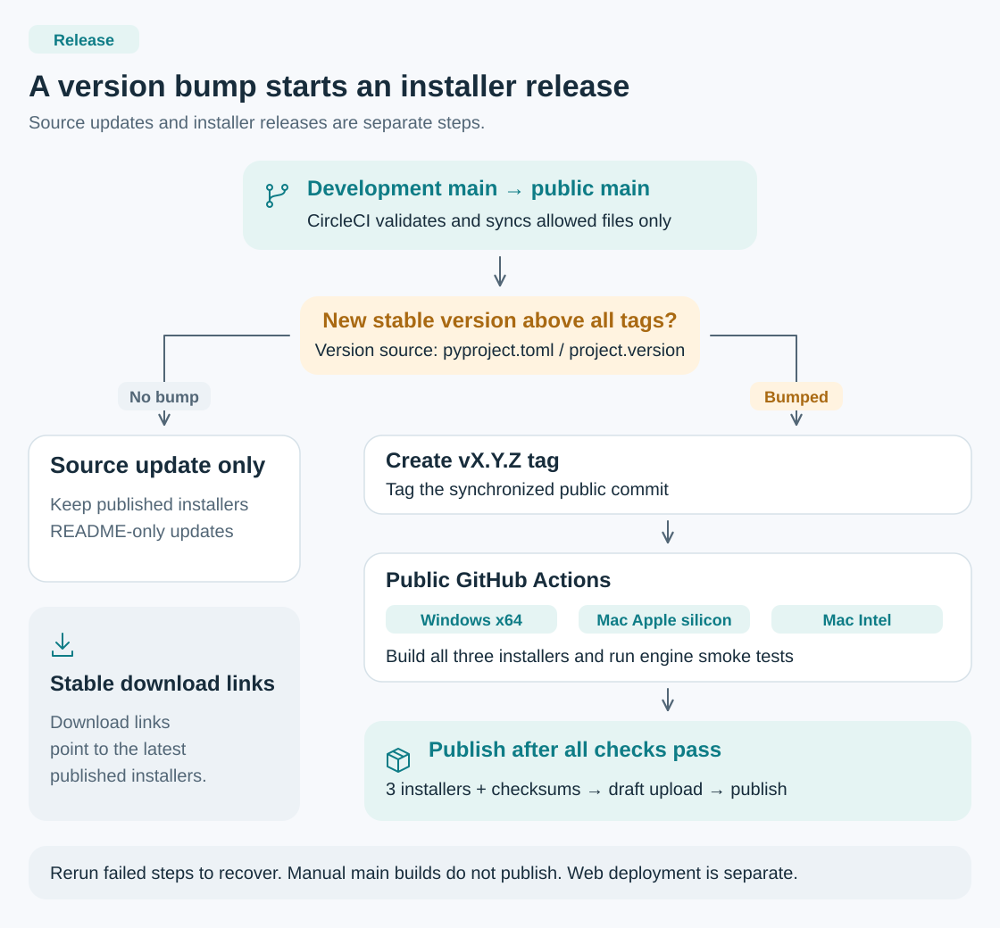

<p align="center"></p>

<h1 align="center">HanJang Jeju <sub>한 장 제주</sub></h1>

<p align="center"><strong>From CSV to a one-page report, with the numbers behind it.</strong><br>Clean data, explore changes and forecast monthly trends on your desktop.</p>

<p align="center"><strong>English</strong> | <a href="README.ko.md">한국어</a> | <a href="README.zh-CN.md">简体中文</a> | <a href="README.ja.md">日本語</a></p>

<p align="center"><a href="https://hanjang-jeju.hyunolike.dev">Try the web demo</a> · <a href="#get-started">Download for desktop</a> · <a href="https://github.com/hyunolike/hanjang-jeju/releases/latest">Latest release</a></p>

<p align="center">
  <a href="https://github.com/hyunolike/hanjang-jeju/releases/latest/download/HanJangJeju-Setup-windows-x64.exe"><picture><source media="(prefers-color-scheme: dark)" srcset="assets/dl-windows-en-dark.svg"></picture></a>
  <a href="https://github.com/hyunolike/hanjang-jeju/releases/latest/download/HanJangJeju-mac-arm64.dmg"><picture><source media="(prefers-color-scheme: dark)" srcset="assets/dl-mac-arm64-en-dark.svg"></picture></a>
  <a href="https://github.com/hyunolike/hanjang-jeju/releases/latest/download/HanJangJeju-mac-x64.dmg"><picture><source media="(prefers-color-scheme: dark)" srcset="assets/dl-mac-x64-en-dark.svg"></picture></a>
</p>

<p align="center"><strong>With local AI — app and model in one download</strong></p>

<p align="center">
  <a href="https://github.com/hyunolike/hanjang-jeju/releases/latest/download/HanJangJeju-Setup-windows-x64-AI.exe"><picture><source media="(prefers-color-scheme: dark)" srcset="assets/dl-windows-ai-en-dark.svg"></picture></a>
  <a href="https://github.com/hyunolike/hanjang-jeju/releases/latest/download/HanJangJeju-mac-arm64-AI.dmg"><picture><source media="(prefers-color-scheme: dark)" srcset="assets/dl-mac-arm64-ai-en-dark.svg"></picture></a>
  <a href="https://github.com/hyunolike/hanjang-jeju/releases/latest/download/HanJangJeju-mac-x64-AI.dmg"><picture><source media="(prefers-color-scheme: dark)" srcset="assets/dl-mac-x64-ai-en-dark.svg"></picture></a>
</p>

HanJang Jeju turns CSV files from the Jeju Big Data Center into a report you can print or save as a PDF. Review column meanings, missing values, subtotals and units before exploring changes. Analysis cards link their numbers to supporting facts.

**Desktop analysis runs on your computer.** The web demo sends uploaded CSV files to a server for analysis. Use the desktop app for data that must stay on your PC.

> The app interface, sample column names and demo video are currently in Korean. These translations cover documentation, not app localization. English is the reference README for installation and development instructions.

[Demo](#demo) · [Features](#features) · [Get started](#get-started) · [Usage](#usage) · [Data and privacy](#privacy) · [Development](#development) · [Contributing](#contributing)

<a id="demo"></a>
## See it in 22 seconds

https://github.com/user-attachments/assets/9d5a5a77-5464-4ebb-a330-0ef7943ae91f

[Download the demo video](https://github.com/hyunolike/hanjang-jeju/raw/main/assets/intro.mp4) if the player is unavailable. You can also [try the web demo](https://hanjang-jeju.hyunolike.dev) with a built-in example.

<a id="features"></a>
## What you can do

| Feature | What to expect |
| --- | --- |
| Read and clean UTF-8/CP949 CSV files | Distinguish missing values, suppressed values and subtotal rows |
| Explore changes, shares and rankings | Review numeric columns and units before calculating |
| Plan an analysis with a question | An optional model proposes a plan; code calculates the numbers. Manual selection works without a model |
| Forecast monthly values | At least 24 months are required; includes 80% prediction intervals |
| Print or save a one-page PDF | Keep selected conditions, a summary and supporting numbers together |

Forecasting starts with a seasonal baseline that repeats the same month's value. AutoETS or AutoARIMA is selected when it performs better on the validation period. Estimates are shown separately from observations. Insufficient history or missing months produce an explanation instead of a forecast.

<a id="get-started"></a>
## Get started

### Choose desktop or web

| | Desktop app | [Web demo](https://hanjang-jeju.hyunolike.dev) |
| --- | --- | --- |
| Best for | Keeping data on your own PC | Trying the app or analyzing CSV files you are allowed to share publicly |
| CSV processing | On your computer | Sent to the server and processed during the request |
| Optional question planning | Local AI pack (llama.cpp) or Ollama | Connected Cloudflare AI |
| Information sent to the model | Question, column metadata and limited category examples used for planning | Question and column metadata; raw CSV rows are not sent to the model |
| Input limits | CSV files the app can read | CSV up to 3 MiB, 20,000 rows and 50 columns |

The web demo needs dates suitable for monthly analysis and an additive numeric measure. It explains why year-only dates, averages or ratios cannot be used for that aggregation. Built-in examples can also use precomputed aggregates.

### Download and install

These links point to the latest published installers. On a Mac, check your chip under **Apple menu → About This Mac**.

| Platform | Download |
| --- | --- |
| Windows 10/11, 64-bit | [Windows installer (.exe)](https://github.com/hyunolike/hanjang-jeju/releases/latest/download/HanJangJeju-Setup-windows-x64.exe) |
| Windows 10/11, 64-bit, **with local AI** (about 1.2 GB) | [Windows installer with AI (.exe)](https://github.com/hyunolike/hanjang-jeju/releases/latest/download/HanJangJeju-Setup-windows-x64-AI.exe) |
| Windows AI pack (optional, about 1.1 GB) | [AI pack installer (.exe)](https://github.com/hyunolike/hanjang-jeju/releases/latest/download/HanJangJeju-AI-Pack-windows-x64.exe) |
| Mac with Apple silicon (M1 or later) | [Apple silicon (.dmg)](https://github.com/hyunolike/hanjang-jeju/releases/latest/download/HanJangJeju-mac-arm64.dmg) |
| Mac with Apple silicon, **with local AI** (about 1.3 GB) | [Apple silicon with AI (.dmg)](https://github.com/hyunolike/hanjang-jeju/releases/latest/download/HanJangJeju-mac-arm64-AI.dmg) |
| Mac with an Intel chip | [Intel (.dmg)](https://github.com/hyunolike/hanjang-jeju/releases/latest/download/HanJangJeju-mac-x64.dmg) |
| Mac with an Intel chip, **with local AI** (about 1.3 GB) | [Intel with AI (.dmg)](https://github.com/hyunolike/hanjang-jeju/releases/latest/download/HanJangJeju-mac-x64-AI.dmg) |

[All release files and SHA256 checksums](https://github.com/hyunolike/hanjang-jeju/releases/latest)

**Windows:** Run the installer; administrator rights are not required. The app is unsigned, so Windows SmartScreen may appear. For the installer downloaded from this repository, select **More info → Run anyway**. Open **한 장 제주** from the Start menu. The first engine startup may take 30–60 seconds. Uninstall through **Settings → Apps → Installed apps**.

**macOS:** Open the DMG and drag the app into **Applications**. The app has no Apple developer certificate. On macOS 15 or later, use **System Settings → Privacy & Security → Open Anyway** if prompted. On earlier versions, **Control-click → Open** in Finder.

### Optional: ask questions on desktop

Manual analysis does not need an AI model. The easiest way to ask questions is to install a **with local AI** edition above: the app and the model are installed together and work without the internet. If you already installed the standard Windows edition, close the app, run the [AI pack installer](https://github.com/hyunolike/hanjang-jeju/releases/latest/download/HanJangJeju-AI-Pack-windows-x64.exe) (no administrator rights or internet needed after download, so you can carry it on a USB drive), then open **한 장 제주** again. The question box shows **로컬 AI 준비됨 (Qwen3 1.7B, AI 팩)** when the model is loaded; the first load can take about a minute.

The AI pack contains a pinned llama.cpp CPU build and the Qwen3 1.7B model (Q4_K_M). The app starts it only on `127.0.0.1` with a new key for each run, and stops it when the app closes. The model receives the question, column metadata and limited category examples, never raw CSV rows.

If you installed the standard Mac edition, or already use [Ollama](https://ollama.com/download), install Ollama and run:

```bash
ollama pull qwen3:1.7b
```

If no model is available, select analysis options manually. Desktop analysis runs without the internet or an external AI service.

<a id="usage"></a>
## From CSV to report

1. **Load a CSV** or start with a built-in example.
2. **Review the fields:** confirm the date, numeric value, unit and filters. The web demo suggests candidates and asks you to clarify ambiguous meanings.
3. **Explore changes and evidence:** inspect charts and fact IDs on analysis cards. Request a forecast when needed.
4. **Take your one-page result:** review conditions, summary and evidence tables, then print or save as a PDF.

<a id="privacy"></a>
## Data and privacy

**Do not upload center originals or competition-provided restricted data to the public web demo.** Public installers include two synthetic example datasets created from publicly documented column definitions. They contain neither actual center data nor original Jeju Data Hub CSV files.

- **Desktop:** the engine listens only on `127.0.0.1`. Automatic cleanup on exit is enabled by default. It removes uploaded working files when the window closes and clears leftovers from an abnormal exit on the next startup. You can disable it or clear the workspace manually. Original files and separately saved PDFs are outside that cleanup scope.
- **Web:** uploads are processed during the request, and upload resources are closed afterward. The demo provides no upload retrieval or permanent file storage feature. CSV files reach the server even though raw rows are not sent to the planning model.

<a id="development"></a>
## Development

Windows uses WPF and WebView2; macOS uses Photino and WKWebView. Both apps share a Python analysis engine and React interface. The optional local model plans analyses; the engine computes the numbers.

<p align="center"><picture><source media="(prefers-color-scheme: dark)" srcset="assets/system-architecture-en-dark.svg"></picture></p>

<details>
<summary>Run and build from source</summary>

Prerequisites: Python 3.11+, [uv](https://docs.astral.sh/uv/), Node.js 22 and pnpm 10. Desktop builds also need .NET 10; Windows installers need Inno Setup.

```bash
git clone https://github.com/hyunolike/hanjang-jeju.git
cd hanjang-jeju
uv sync --frozen
bash scripts/run-web.sh
```

On Windows, use `scripts\run-web.bat` instead of the shell script. Follow the [release workflow](.github/workflows/release.yml) for the full packaging sequence.

```bash
cd web
pnpm install --frozen-lockfile
pnpm build
cd ..
JEJU_PUBLIC=1 uv run pyinstaller packaging/engine.spec --noconfirm --distpath output/dist --workpath output/build
```

On macOS, then run `JEJU_PUBLIC=1 mac/build-app.sh` to build the public engine, app and DMG. On Windows, publish the app with `dotnet publish`, bundle the engine and package it with Inno Setup. The version comes from `project.version` in `pyproject.toml`. For a manual Windows installer build, set the `APP_VERSION` environment variable to the output of `uv run python scripts/release_version.py`.

</details>

### How releases work

This repository is a public distribution synchronized from the development source using an explicit file allowlist. A source update with the same version does not replace published installers. A new stable version above existing tags triggers a public tag, Windows x64 and macOS arm64/x64 builds, and engine smoke tests. After all succeed, installers and checksums are uploaded to a draft release and published. Web deployment is separate; manually building `main` does not publish a release.

<p align="center"><picture><source media="(prefers-color-scheme: dark)" srcset="assets/release-automation-en-dark.svg"></picture></p>

Check [GitHub Releases](https://github.com/hyunolike/hanjang-jeju/releases/latest) for what is actually available to download.

<a id="contributing"></a>
## Feedback and contributions

Found a bug or a translation issue? [Open an issue](https://github.com/hyunolike/hanjang-jeju/issues). Include your OS, app version, reproduction steps, and expected and actual behavior. Use a minimal synthetic CSV when needed; do not attach confidential files.

This public repository is generated from the development source. Direct changes here can be overwritten by the next sync. Discuss code or translation changes in an issue first so they can be applied to the maintained source. Update all four READMEs together when features or installation steps change.

<a id="credits"></a>
## Project and credits

Created for the Jeju AI & Big Data AI Agent Development Challenge. Planning, design and development by [hyunolike](https://github.com/hyunolike).

Built with pandas, statsforecast, FastAPI, uvicorn, PyInstaller, React, Vite, Tailwind CSS, Microsoft WebView2, Photino.NET and Inno Setup. These dependencies retain their respective licenses. This repository does not currently include a project `LICENSE` file.
