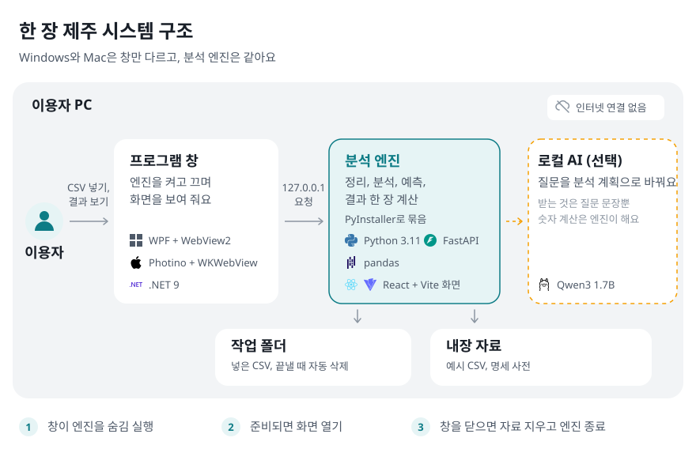
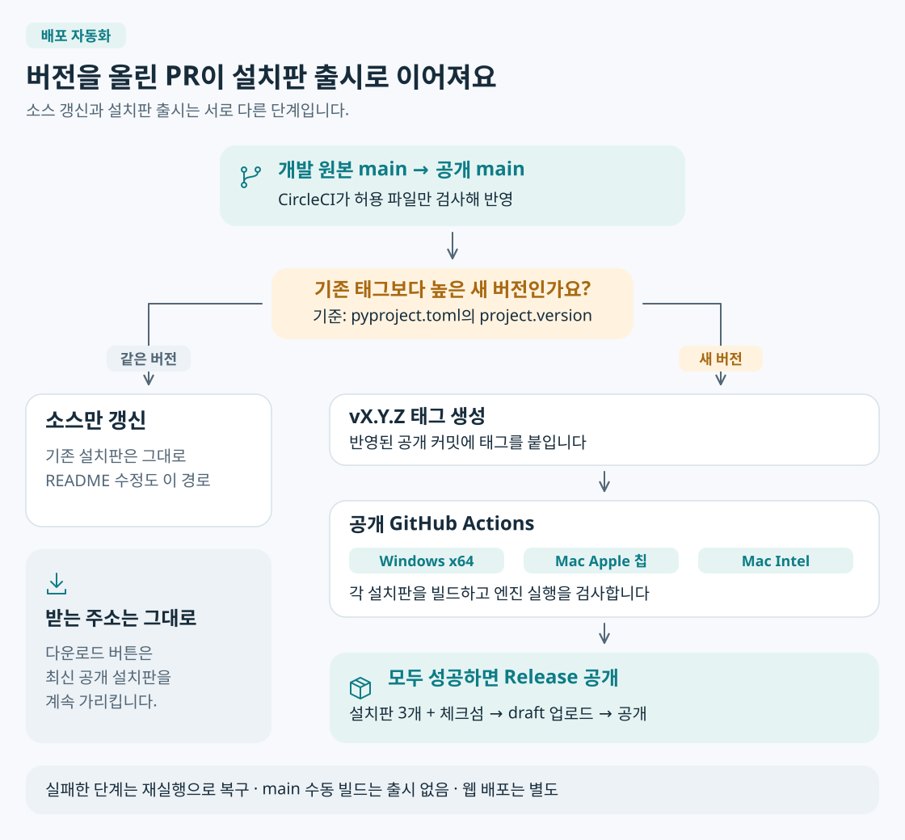

<p align="center"></p>

<h1 align="center">한 장 제주</h1>

<p align="center"><strong>CSV에서 보고서에 붙일 결과 한 장까지.</strong><br>자료를 정리하고 변화를 찾고, 숫자의 근거를 함께 보여 줍니다.</p>

<p align="center"><a href="https://hanjang-jeju.hyunolike.dev">웹으로 먼저 써 보기</a> · <a href="#내려받기">PC에 설치하기</a> · <a href="#어떻게-사용하나요">사용 방법</a></p>

<p align="center">
  <a href="https://github.com/hyunolike/hanjang-jeju/releases/latest/download/HanJangJeju-Setup-windows-x64.exe"><picture><source media="(prefers-color-scheme: dark)" srcset="assets/dl-windows-dark.svg"></picture></a>
  <a href="https://github.com/hyunolike/hanjang-jeju/releases/latest/download/HanJangJeju-mac-arm64.dmg"><picture><source media="(prefers-color-scheme: dark)" srcset="assets/dl-mac-arm64-dark.svg"></picture></a>
  <a href="https://github.com/hyunolike/hanjang-jeju/releases/latest/download/HanJangJeju-mac-x64.dmg"><picture><source media="(prefers-color-scheme: dark)" srcset="assets/dl-mac-x64-dark.svg"></picture></a>
</p>

센터에서 받은 CSV를 분석하려면 열 이름을 해석하고, 빈 값과 소계를 확인하고, 기간을 맞춰야 합니다. 한 장 제주는 이 과정을 정리해 변화와 예측을 보여 주고, 보고서에 옮길 수 있는 결과 한 장을 만듭니다.

**PC용 프로그램은 내 컴퓨터 안에서 분석합니다.** 웹 체험판에서는 공개 가능한 CSV를 서버로 보내 분석합니다. 자료에 맞는 환경을 골라 주세요.

## 22초로 보는 한 장 제주

https://github.com/user-attachments/assets/9d5a5a77-5464-4ebb-a330-0ef7943ae91f

영상이 보이지 않으면 [소개 영상 내려받기](https://github.com/hyunolike/hanjang-jeju/raw/main/assets/intro.mp4)로 볼 수 있습니다.

## 어떻게 사용하나요?

1. **CSV를 넣습니다.** 내 파일을 선택하거나 공개 예시로 시작합니다.
2. **분석할 항목을 확인합니다.** 날짜와 값, 단위를 보고 필요한 조건을 고릅니다. 공개 웹에서는 후보를 추천하고, 뜻이 불명확한 값은 확인을 요청합니다.
3. **변화와 근거를 봅니다.** 그래프와 분석 카드의 사실 번호로 계산 근거를 확인합니다. 필요한 경우 예측을 요청합니다.
4. **결과 한 장을 가져갑니다.** 조건, 요약과 근거 표를 확인한 뒤 인쇄하거나 PDF로 저장합니다.

| 할 수 있는 일 | 알아 둘 점 |
| --- | --- |
| UTF-8/CP949 CSV 읽기와 정리 | 빈 값, 가려진 값과 소계 행을 구분합니다 |
| 기간별 변화와 구성비·순위 분석 | 계산 가능한 값과 단위를 확인한 뒤 분석합니다 |
| 질문으로 분석 계획 만들기 | 계획은 모델이 만들고 계산은 코드가 합니다. 모델 없이 직접 선택할 수도 있습니다 |
| 월별 예측과 80% 예측 구간 | 최소 24개월이 필요합니다. 자료가 부족하거나 빈 달이 있으면 이유를 안내합니다 |
| 인쇄와 PDF | 선택 조건과 숫자 근거를 결과에 함께 남깁니다 |

예측은 같은 달의 값을 반복하는 계절 기준선을 사용하고, 검증 구간에서 더 나은 경우에 AutoETS나 AutoARIMA를 선택합니다. 추정값은 실제 관측값과 구분해 표시합니다.

## PC와 웹, 어디서 쓸까요?

| | PC용 프로그램 | [웹 체험판](https://hanjang-jeju.hyunolike.dev) |
| --- | --- | --- |
| 이런 때 쓰세요 | 자료를 내 PC 안에서 분석할 때 | 설치 전에 체험하거나 공개 CSV를 분석할 때 |
| 파일 처리 | 내 PC에서 처리 | 서버로 전송해 요청 중 처리 |
| 질문 기능 | 선택 사항인 로컬 Ollama | 연결된 Cloudflare AI로 계획 생성 |
| 모델에 보내는 정보 | 질문과 열 정의 등 계획용 정보 | 질문과 열 정의 등 계획용 정보. CSV 원본 행은 보내지 않음 |
| 크기와 형식 | 프로그램에서 읽을 수 있는 CSV | 3 MiB, 20,000행, 50열 이하 CSV |

**센터 원본과 주최 제공 제한 자료는 공개 웹에 넣지 마세요.** 웹은 월별 분석에 사용할 날짜와 합산 가능한 값이 필요합니다. 연도만 있거나 평균·비율처럼 합산할 수 없는 값은 이유를 안내합니다. 공개 예시는 미리 계산한 집계 결과로도 체험할 수 있습니다.

PC판은 인터넷과 외부 AI 없이 분석할 수 있습니다. 설치 파일과 선택 사항인 AI 모델을 처음 내려받을 때는 인터넷이 필요합니다. 프로그램의 분석 엔진은 내 PC의 `127.0.0.1`에서만 열립니다.

## 내려받기

아래 링크는 최신 공개 설치판을 가리킵니다. 내 Mac의 칩은 **Apple 메뉴 → 이 Mac에 관하여**에서 확인합니다.

| 컴퓨터 | 설치 파일 |
| --- | --- |
| Windows 10/11, 64비트 | [Windows용 exe](https://github.com/hyunolike/hanjang-jeju/releases/latest/download/HanJangJeju-Setup-windows-x64.exe) |
| Mac, Apple 칩(M1 이후) | [Apple 칩용 dmg](https://github.com/hyunolike/hanjang-jeju/releases/latest/download/HanJangJeju-mac-arm64.dmg) |
| Mac, Intel 칩 | [Intel용 dmg](https://github.com/hyunolike/hanjang-jeju/releases/latest/download/HanJangJeju-mac-x64.dmg) |

[모든 설치 파일과 SHA256 체크섬 보기](https://github.com/hyunolike/hanjang-jeju/releases/latest)

공개 설치판의 예시 자료는 공개 명세서의 열 정의로 만든 **가짜 값 2종**입니다. 실제 센터 자료나 제주데이터허브 원본 CSV는 포함하지 않습니다.

## 설치하기

### Windows

1. exe를 실행합니다. 관리자 권한은 필요하지 않습니다.
2. 코드 서명이 없어 **Windows의 PC 보호**가 표시되면 **추가 정보 → 실행**으로 진행합니다.
3. 시작 메뉴에서 **한 장 제주**를 엽니다. 처음에는 엔진 준비에 30초에서 1분 정도 걸릴 수 있습니다.

삭제할 때는 **설정 → 앱 → 설치된 앱**에서 한 장 제주를 제거합니다.

### Mac

1. dmg를 열고 앱을 **응용 프로그램** 폴더로 끌어다 놓습니다.
2. 앱을 엽니다. 개발자 인증서가 없어 처음 실행할 때 확인 안내가 나타날 수 있습니다.
3. macOS 15 이후에서는 **시스템 설정 → 개인정보 보호 및 보안 → 그래도 열기**로 진행합니다. 이전 버전에서는 Finder에서 앱을 **Control+클릭 → 열기**로 실행합니다.

### PC에서 질문 기능 켜기

분석할 항목을 질문으로 고르고 싶을 때만 설정하면 됩니다. 직접 선택하는 분석에는 필요하지 않습니다.

1. [Ollama](https://ollama.com/download)를 설치하고 실행합니다.
2. 터미널 또는 Windows PowerShell에서 모델을 받습니다.

```bash
ollama pull qwen3:1.7b
```

모델은 내 PC에서 실행됩니다. 사용할 수 없으면 직접 항목을 골라 분석할 수 있습니다.

## 작업을 마치면

PC판의 **끝낼 때 자동 지우기**는 기본으로 켜져 있습니다. 창을 닫을 때 업로드한 작업 파일을 지우고, 비정상 종료로 남은 파일은 다음 시작 때 정리합니다. 설정을 끌 수도 있고 **지금 지우기**로 직접 정리할 수도 있습니다. 사용자가 따로 저장한 PDF와 원본 파일은 이 작업 폴더 정리 대상에 포함되지 않습니다.

공개 웹은 업로드 파일을 요청 중 처리하고 처리가 끝나면 업로드 자원을 닫습니다. 파일을 조회하거나 영구 보관하는 기능을 제공하지 않습니다.

## 소스를 살펴보려면

Windows는 WPF와 WebView2, Mac은 Photino와 WKWebView로 창을 엽니다. 두 앱은 같은 Python 분석 엔진과 React 화면을 사용합니다.

<p align="center"><picture><source media="(prefers-color-scheme: dark)" srcset="assets/system-architecture-dark.svg"></picture></p>

이 저장소는 개발 원본에서 허용한 파일을 자동으로 반영한 공개 배포판입니다. 소스가 갱신돼도 버전이 같으면 설치판은 바뀌지 않습니다. 실제 배포 내용은 [Release](https://github.com/hyunolike/hanjang-jeju/releases/latest)를 기준으로 확인하세요.

<p align="center"><picture><source media="(prefers-color-scheme: dark)" srcset="assets/release-automation-dark.svg"></picture></p>

<details>
<summary>소스에서 실행하고 빌드하기</summary>

Python 3.11 이상과 uv, Node.js 22와 pnpm 10이 필요합니다. 앱 빌드에는 .NET 10, Windows 설치판에는 Inno Setup이 추가로 필요합니다.

```bash
uv sync --frozen
bash scripts/run-web.sh
```

Windows에서는 `scripts\run-web.bat`를 사용합니다. 설치판 빌드는 [release workflow](.github/workflows/release.yml)의 순서를 따릅니다.

```bash
cd web
pnpm install --frozen-lockfile
pnpm build
cd ..
JEJU_PUBLIC=1 uv run pyinstaller packaging/engine.spec --noconfirm --distpath output/dist --workpath output/build
```

Mac에서는 이어서 `JEJU_PUBLIC=1 mac/build-app.sh`를 실행하면 공개용 엔진과 앱, dmg를 만듭니다. Windows에서는 `dotnet publish`로 앱을 만들고 엔진을 함께 넣은 뒤 Inno Setup으로 묶습니다. 버전은 `pyproject.toml`의 `project.version`을 사용하며, Windows 설치판을 직접 만들 때는 `uv run python scripts/release_version.py`의 출력을 `APP_VERSION` 환경변수로 설정합니다.

</details>

## 프로젝트 안내

「제주 AI·빅데이터 활용 AI Agent 개발 챌린지」 출품작입니다. 기획, 디자인과 개발은 [hyunolike](https://github.com/hyunolike)가 맡았습니다.

사용한 주요 오픈소스는 pandas, statsforecast, FastAPI, uvicorn, PyInstaller, React, Vite, Tailwind CSS, Microsoft WebView2, Photino.NET과 Inno Setup입니다. 각 프로젝트의 라이선스를 따릅니다.
