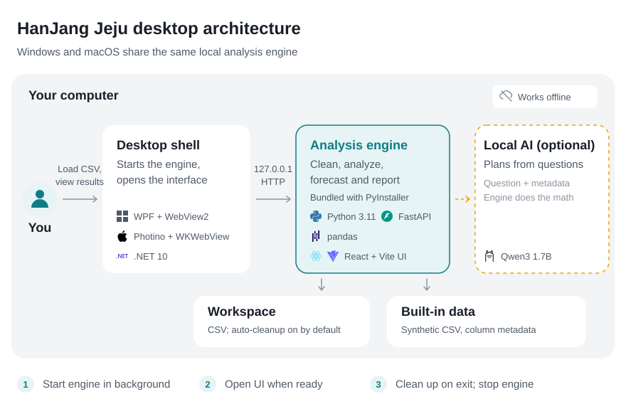
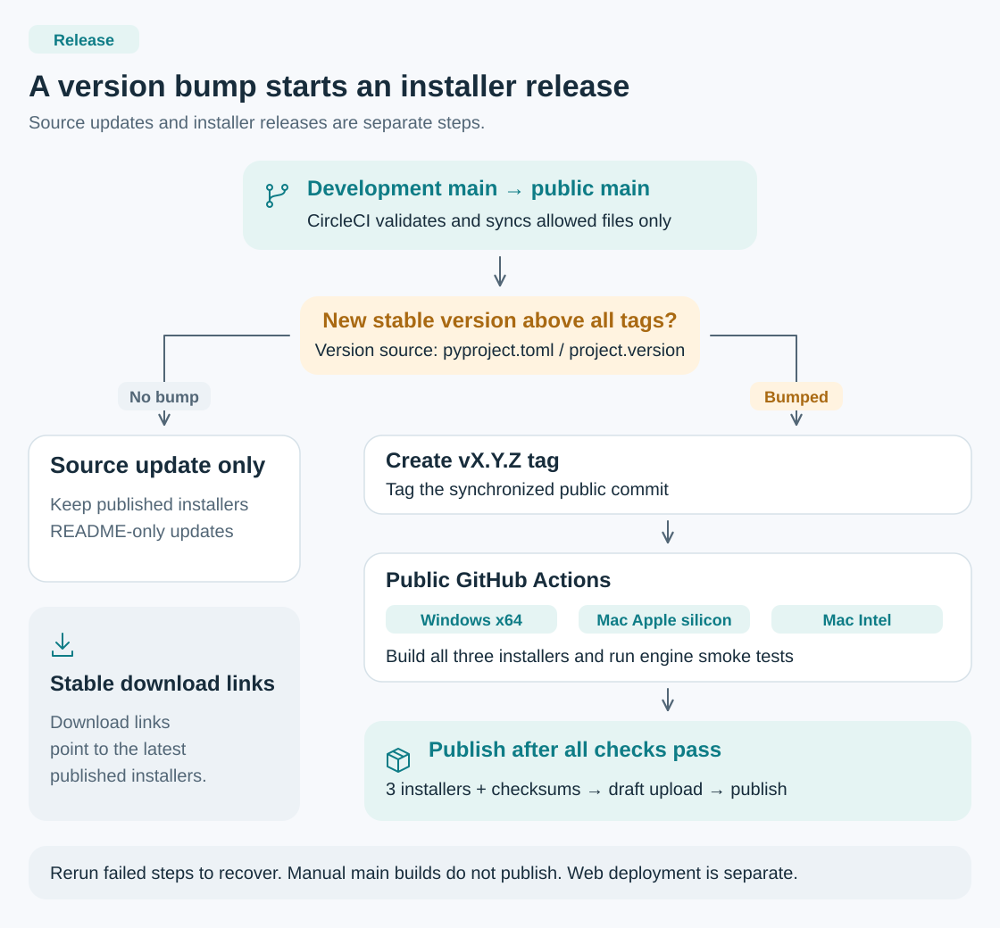

<p align="center"></p>

<h1 align="center">HanJang Jeju <sub>한 장 제주</sub></h1>

<p align="center"><strong>从 CSV 到单页报告，每个数字都有依据。</strong><br>在桌面端清洗数据、查看变化，并预测月度趋势。</p>

<p align="center"><a href="README.md">English</a> | <a href="README.ko.md">한국어</a> | <strong>简体中文</strong> | <a href="README.ja.md">日本語</a></p>

<p align="center"><a href="https://hanjang-jeju.hyunolike.dev">体验网页版</a> · <a href="#get-started">下载桌面版</a> · <a href="https://github.com/hyunolike/hanjang-jeju/releases/latest">最新版本</a></p>

HanJang Jeju 可将济州大数据中心的 CSV 文件转为可打印或保存为 PDF 的报告。分析前先核对列含义、缺失值、小计和单位；分析卡片中的数字可通过事实编号追溯到计算依据。

**桌面版在你的电脑上分析数据。** 网页体验版会将上传的 CSV 发送到服务器进行分析。必须留在本机的数据请使用桌面版处理。

> 目前应用界面、示例列名和演示视频均为韩语。README 翻译不代表应用已支持相应语言。安装与开发说明以[英文 README](README.md)为准。

[演示](#demo) · [功能](#features) · [开始使用](#get-started) · [使用流程](#usage) · [数据与隐私](#privacy) · [开发](#development) · [参与贡献](#contributing)

<a id="demo"></a>
## 22 秒了解 HanJang Jeju

https://github.com/user-attachments/assets/9d5a5a77-5464-4ebb-a330-0ef7943ae91f

无法播放时可[下载演示视频](https://github.com/hyunolike/hanjang-jeju/raw/main/assets/intro.mp4)，也可在[网页体验版](https://hanjang-jeju.hyunolike.dev)中使用内置示例。

<a id="features"></a>
## 主要功能

| 功能 | 说明 |
| --- | --- |
| 读取并清洗 UTF-8/CP949 CSV | 区分缺失值、隐去值和小计行 |
| 分析变化、占比和排名 | 先核对数值列及其单位，再执行计算 |
| 通过提问制定分析计划 | 可选模型负责提出计划，代码负责计算；也可不使用模型，手动选择 |
| 预测月度数值 | 至少需要 24 个月的数据，并提供 80% 预测区间 |
| 打印或保存单页 PDF | 在同一页保留筛选条件、摘要和数字依据 |

预测首先采用重复同月数值的季节性基线。AutoETS 或 AutoARIMA 在验证时段表现更好时，才会被选用。预测值与观测值分开显示；历史数据不足或存在缺失月份时，会说明原因，不生成预测。

<a id="get-started"></a>
## 开始使用

### 选择桌面版或网页版

| | 桌面版 | [网页体验版](https://hanjang-jeju.hyunolike.dev) |
| --- | --- | --- |
| 适用场景 | 数据必须留在本机 | 体验应用，或分析允许公开分享的 CSV |
| CSV 处理位置 | 本机 | 发送到服务器，在请求期间处理 |
| 可选的提问规划功能 | 本地 Ollama | 已接入的 Cloudflare AI |
| 发送给模型的信息 | 问题、列元数据和少量类别值示例，用于制定计划 | 问题和列元数据，不发送 CSV 原始数据行 |
| 输入范围 | 应用能够读取的 CSV | 不超过 3 MiB、20,000 行、50 列的 CSV |

网页版需要适合按月分析的日期，以及可求和的数值。仅有年份的日期、平均值或比率等不适合该聚合方式时，会说明原因。内置示例也可通过预先计算的汇总结果进行体验。

### 下载与安装

以下链接始终指向最新发布的安装包。Mac 用户可在 **Apple 菜单 → 关于本机** 中查看芯片类型。

| 平台 | 下载 |
| --- | --- |
| Windows 10/11，64 位 | [Windows 安装程序（.exe）](https://github.com/hyunolike/hanjang-jeju/releases/latest/download/HanJangJeju-Setup-windows-x64.exe) |
| Apple 芯片 Mac（M1 及之后） | [Apple 芯片版（.dmg）](https://github.com/hyunolike/hanjang-jeju/releases/latest/download/HanJangJeju-mac-arm64.dmg) |
| Intel 芯片 Mac | [Intel 版（.dmg）](https://github.com/hyunolike/hanjang-jeju/releases/latest/download/HanJangJeju-mac-x64.dmg) |

[查看所有安装文件和 SHA256 校验和](https://github.com/hyunolike/hanjang-jeju/releases/latest)

**Windows：**运行安装程序，无需管理员权限。应用尚未进行代码签名，可能触发 Windows SmartScreen。确认文件来自本仓库后，选择**更多信息 → 仍要运行**。从开始菜单打开 **한 장 제주**。首次启动引擎可能需要 30–60 秒。卸载入口为**设置 → 应用 → 已安装的应用**。

**macOS：**打开 DMG，将应用拖入**应用程序**文件夹。应用没有 Apple 开发者证书，首次启动可能需要确认。macOS 15 及之后版本可在**系统设置 → 隐私与安全性 → 仍要打开**中允许启动；较早版本可在访达中按住 **Control 键点按 → 打开**。

### 可选：在桌面版中通过提问选择分析

手动选择分析项目无需 AI 模型。如果需要提问功能，请安装并启动 [Ollama](https://ollama.com/download)，然后在终端或 Windows PowerShell 中运行：

```bash
ollama pull qwen3:1.7b
```

模型在本机运行。模型不可用时仍可手动选择分析项目。首次下载应用和可选模型需要联网；桌面分析无需互联网或外部 AI 服务。

<a id="usage"></a>
## 从 CSV 到报告

1. **载入 CSV**，或从内置示例开始。
2. **核对字段：**确认日期、数值、单位和筛选条件。网页版会推荐候选字段，并请你确认含义不明确的项目。
3. **查看变化与依据：**通过图表和分析卡片中的事实编号查看计算依据，需要时再请求预测。
4. **导出单页结果：**核对条件、摘要和依据表后，打印或保存为 PDF。

<a id="privacy"></a>
## 数据与隐私

**请勿向公开网页版上传中心原始数据或比赛主办方提供的受限资料。** 公开安装包仅包含根据公开列定义构造的两组合成示例，不包含真实中心数据或济州数据平台的原始 CSV。

- **桌面版：**分析引擎仅监听 `127.0.0.1`。默认启用退出时自动清理：关闭窗口时删除上传的工作文件，异常退出遗留的文件会在下次启动时清理。可关闭该设置或手动清理工作目录。原始文件和另行保存的 PDF 不在清理范围内。
- **网页版：**上传文件在请求期间处理，处理结束后关闭上传资源。不提供上传文件查询或永久存储功能。即使不向规划模型发送原始数据行，CSV 文件本身仍会传到服务器。

<a id="development"></a>
## 开发

Windows 使用 WPF 和 WebView2，macOS 使用 Photino 和 WKWebView。两个桌面应用共用 Python 分析引擎和 React 界面。可选本地模型制定计划，引擎负责数值计算。

<p align="center"><picture><source media="(prefers-color-scheme: dark)" srcset="assets/system-architecture-en-dark.svg"></picture></p>

<details>
<summary>从源码运行与构建</summary>

需要 Python 3.11+、[uv](https://docs.astral.sh/uv/)、Node.js 22 和 pnpm 10。桌面应用构建还需要 .NET 10；Windows 安装包需要 Inno Setup。

```bash
git clone https://github.com/hyunolike/hanjang-jeju.git
cd hanjang-jeju
uv sync --frozen
bash scripts/run-web.sh
```

Windows 使用 `scripts\run-web.bat`，而非上述 Shell 脚本。完整打包顺序请参阅 [release workflow](.github/workflows/release.yml)。

```bash
cd web
pnpm install --frozen-lockfile
pnpm build
cd ..
JEJU_PUBLIC=1 uv run pyinstaller packaging/engine.spec --noconfirm --distpath output/dist --workpath output/build
```

macOS 随后运行 `JEJU_PUBLIC=1 mac/build-app.sh`，构建公开版引擎、应用和 DMG。Windows 使用 `dotnet publish` 构建应用，附带引擎后通过 Inno Setup 打包。版本以 `pyproject.toml` 中的 `project.version` 为准。手动构建 Windows 安装包时，将 `uv run python scripts/release_version.py` 的输出设为 `APP_VERSION` 环境变量。

</details>

### 安装包如何发布

本仓库是从开发源仓库按明确的文件允许列表同步的公开分发仓库。版本不变时仅更新源码，已发布的安装包不变。高于现有标签的新稳定版本会触发公开标签、Windows x64 和 macOS arm64/x64 构建及引擎冒烟测试。全部成功后，将安装包和校验和上传到草稿版本，再正式发布。网页版单独部署；手动构建 `main` 不会发布 Release。

<p align="center"><picture><source media="(prefers-color-scheme: dark)" srcset="assets/release-automation-en-dark.svg"></picture></p>

实际可下载的版本以 [GitHub Releases](https://github.com/hyunolike/hanjang-jeju/releases/latest) 为准。

<a id="contributing"></a>
## 反馈与贡献

发现错误或翻译问题？请[提交 Issue](https://github.com/hyunolike/hanjang-jeju/issues)，提供操作系统、应用版本、复现步骤、预期结果和实际结果。如需附带数据，请使用最小合成 CSV，不要上传保密文件。

本公开仓库由开发源仓库生成，直接修改可能被下次同步覆盖。代码或翻译修改请先通过 Issue 讨论，以便应用到维护中的源文件。功能或安装步骤变化时，应同时更新四种语言的 README。

<a id="credits"></a>
## 项目与致谢

本项目为济州 AI 与大数据 AI Agent 开发挑战赛参赛作品，由 [hyunolike](https://github.com/hyunolike) 负责策划、设计和开发。

使用了 pandas、statsforecast、FastAPI、uvicorn、PyInstaller、React、Vite、Tailwind CSS、Microsoft WebView2、Photino.NET 和 Inno Setup。各依赖项遵循各自的许可证。本仓库目前未包含项目 `LICENSE` 文件。
